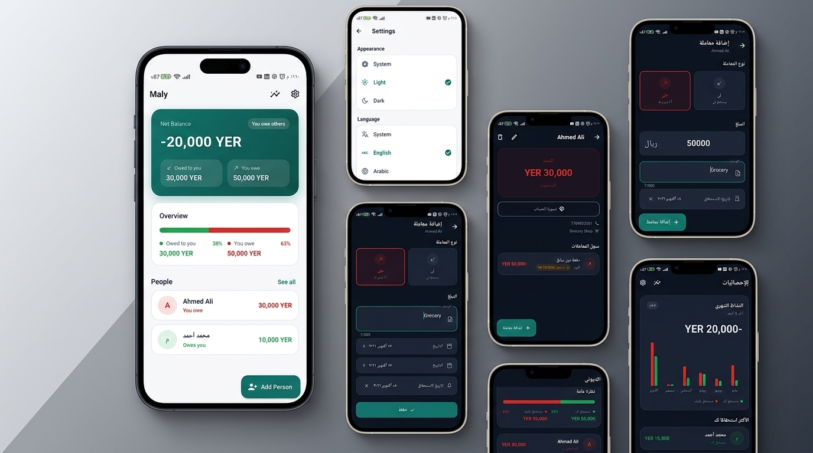

# 💸 Maly

> A polished, offline-first Flutter app for tracking personal debts. Know exactly who owes you — and who you owe — with due-date reminders, a full backup system, and native Arabic RTL support.

---

## 📖 Table of Contents

- [Motivation](#-motivation)
- [Key Features](#-key-features)
- [Screenshots](#-screenshots)
- [Tech Stack](#-tech-stack)
- [Architecture](#-architecture)
- [Folder Structure](#-folder-structure)
- [Installation](#-installation)
- [Challenges Faced](#-challenges-faced)
- [What I Learned](#-what-i-learned)
- [Future Improvements](#-future-improvements)

---

## 💡 Motivation

I built Maly because tracking money between friends and family is surprisingly frustrating. Existing apps either require cloud accounts that expose sensitive financial data, are cluttered with ads, or simply don't support Arabic.

My goals were:

- Go deep on **local persistence** (SQLite via Drift) and reactive state
- Implement **local push notifications** with real timezone scheduling
- Practice layered architecture (MVVM + Repository pattern) with Riverpod
- Ship proper **localization** with full RTL layout support
- Understand the full backup/restore lifecycle using the device file system

---

## ✨ Key Features

| Feature                       | Description                                                                       |
| ----------------------------- | --------------------------------------------------------------------------------- |
| 👥 **People & Balances**      | Add contacts (optionally from your phonebook) and track a live balance per person |
| 💳 **Credit & Debit Entries** | Log "they owe me" or "I owe them" transactions with amounts, dates, and notes     |
| 🔔 **Due Date Reminders**     | Set a due date on any transaction — a local notification fires on that day        |
| 📊 **Dashboard**              | Hero card with net balance + a proportional bar chart of both directions          |
| 🗃️ **Backup & Restore**       | Export the entire SQLite database to a local file and restore it at any time      |
| 🌍 **Localization**           | Full English / Arabic support; layout flips RTL automatically                     |
| 🌓 **Light & Dark Themes**    | Polished Material 3 themes with a consistent color system                         |
| ↔️ **Swipe to Delete**        | Swipe a transaction away with an immediate undo snackbar                          |
| 🔄 **Reactive UI**            | Every screen updates automatically when the database changes — no manual refresh  |

---

## 📸 Screenshots

<p align="center">
  
</p>

## 🛠️ Tech Stack

| Category             | Technology                                                            |
| -------------------- | --------------------------------------------------------------------- |
| **Framework**        | Flutter 3.x (Dart 3.8+)                                               |
| **State Management** | [Riverpod](https://riverpod.dev/) (`StreamProvider`, `AsyncNotifier`) |
| **Local Database**   | [Drift](https://drift.simonbinder.eu/) — type-safe SQLite             |
| **Routing**          | [GoRouter](https://pub.dev/packages/go_router)                        |
| **Notifications**    | `flutter_local_notifications` + `timezone` + `flutter_timezone`       |
| **Backup / Restore** | `file_picker` for save/open dialogs                                   |
| **Contacts**         | `flutter_contacts` for auto-filling person details                    |
| **Localization**     | Flutter `gen-l10n` (`.arb` files → generated Dart)                    |
| **Settings**         | `shared_preferences` (theme mode + language choice)                   |
| **UI Utilities**     | `flutter_slidable` (swipe-to-delete), `intl` (currency & date format) |

---

## 🏗️ Architecture

Maly follows a **layered MVVM architecture** with a strict unidirectional data flow. Every database read is a **Dart stream**, so changing one record fans out to every listening provider simultaneously — no manual refresh logic anywhere.

```
┌────────────────────────────────────────────────────┐
│                 Presentation Layer                 │
│  views/          widgets/          providers/      │
│  HomeScreen      NetBalanceCard    personProviders │
│  PersonScreen    BalanceChartCard  txnProviders    │
│  StatsScreen     TransactionTile   balanceProviders│
│  SettingsScreen  PersonTile        statsProviders  │
├────────────────────────────────────────────────────┤
│               ViewModel Layer                      │
│  viewmodels/                                       │
│  PersonViewModel  TransactionViewModel             │
│  BackupViewModel                                   │
├────────────────────────────────────────────────────┤
│                  Domain Layer                      │
│  domain/entities/                                  │
│  DashboardTotals   TransactionType                 │
│  MonthlyTotals                                     │
├────────────────────────────────────────────────────┤
│                   Data Layer                       │
│  data/local/database/   data/repositories/         │
│  AppDatabase            DebtRepository             │
│  tables.dart            (single source of truth)   │
│  data/backup/                                      │
│  BackupService                                     │
├────────────────────────────────────────────────────┤
│                 Services Layer                     │
│  services/                                         │
│  NotificationService                               │
│  (timezone-aware scheduling)                       │
└────────────────────────────────────────────────────┘
```

**Data Flow:**

1. **Read:** `Screen` → watches `StreamProvider` → `DebtRepository` → Drift stream → SQLite
2. **Write:** `Screen` → calls `ViewModel` method → `DebtRepository` → Drift → SQLite → stream emits → all providers rebuild automatically

**Key pattern — Repository as single source of truth:**

```dart
// Every query returns a Stream — the UI never polls, it just listens.
Stream<List<PersonWithBalance>> watchAllPersons();
Stream<DashboardTotals> watchDashboardTotals();
Stream<List<Transaction>> watchTransactionsForPerson(int personId);
```

Adding a transaction automatically triggers a rebuild in the dashboard
totals, the person's balance card, and the transaction list — all from
one SQLite write.

---

## 📁 Folder Structure

```
lib/
├── main.dart                         # Entry point: loads prefs, starts app
│
├── core/
│   ├── constants/app_colors.dart     # Single source for all app colors
│   ├── theme/app_theme.dart          # Light & dark ThemeData
│   ├── theme/theme_provider.dart     # Riverpod provider for ThemeMode
│   ├── locale/locale_provider.dart   # Riverpod provider for Locale
│   ├── router/app_router.dart        # GoRouter route definitions
│   ├── settings/settings_service.dart# SharedPreferences wrapper
│   └── utils/                        # Currency & date formatters
│
├── domain/
│   └── entities/                     # Pure Dart value objects
│       ├── dashboard_totals.dart
│       ├── monthly_totals.dart
│       └── transaction_type.dart     # Enum: credit | debit
│
├── data/
│   ├── local/database/
│   │   ├── tables.dart               # Drift table definitions
│   │   ├── app_database.dart         # AppDatabase class
│   │   └── app_database.g.dart       # Generated Drift code (committed)
│   ├── repositories/
│   │   └── debt_repository.dart      # All DB reads/writes in one place
│   └── backup/
│       └── backup_service.dart       # Export/import SQLite file
│
├── presentation/
│   ├── providers/                    # StreamProviders (reads)
│   │   ├── balance_providers.dart
│   │   ├── person_providers.dart
│   │   ├── transaction_providers.dart
│   │   ├── stats_providers.dart
│   │   └── core_providers.dart
│   ├── viewmodels/                   # AsyncNotifiers (writes)
│   │   ├── person_viewmodel.dart
│   │   ├── transaction_viewmodel.dart
│   │   └── backup_viewmodel.dart
│   ├── views/
│   │   ├── home/home_screen.dart
│   │   ├── person/
│   │   ├── transaction/
│   │   ├── stats/
│   │   └── settings/
│   └── widgets/                      # Reusable, self-contained components
│       ├── balance_card.dart         # NetBalanceCard + BalanceCard
│       ├── balance_chart_card.dart   # Proportional bar chart
│       ├── transaction_tile.dart     # Slidable transaction row
│       ├── person_tile.dart          # Person row with live balance
│       ├── money_text.dart           # Fixed-width digit amount display
│       ├── empty_state.dart
│       └── error_view.dart
│
├── services/
│   └── notification_service.dart     # Timezone-aware local notifications
│
└── l10n/
    ├── app_en.arb                    # English strings
    └── app_ar.arb                    # Arabic strings
```

---

## 🚀 Installation

### Prerequisites

- Flutter SDK with Dart 3.8+
- Android Studio or VS Code with the Flutter extension

### Steps

```bash
# 1. Clone the repository
git clone https://github.com/HasanAlhamadi/maly.git
cd maly

# 2. Install dependencies
flutter pub get

# 3. Generate Drift database code (already committed, only needed after
#    editing tables.dart)
dart run build_runner build -d

# 4. Generate localization files (already committed, only needed after
#    editing lib/l10n/*.arb)
flutter gen-l10n

# 5. Run the app
flutter run
```

---

## 🧗 Challenges Faced

### 1. Keeping Every Screen in Sync Without Manual Refresh

**Problem:** When a transaction is added on the person detail screen, the
home screen's net balance and the dashboard chart also need to update.
With a one-shot `Future`, every screen would need explicit refresh logic.

**Solution:** Every repository method returns a **Drift stream**. Drift
re-emits the query result whenever the underlying table changes. Wrapping
these in Riverpod `StreamProvider`s means every listening widget rebuilds
automatically — one write, every screen updates.

### 2. Timezone-Aware Notification Scheduling

**Problem:** `flutter_local_notifications` requires an `TZDateTime` for
scheduling, not a plain `DateTime`. The device's local timezone name had to
be resolved at runtime, and the timezone database had to be initialized
before the first schedule call.

**Solution:** Used `flutter_timezone` to get the device's IANA timezone
name, initialized the `tz` package with `tz.initializeTimeZones()` at
startup, and converted all due dates via `tz.TZDateTime.from(date, local)`.

### 3. RTL Layout with a Custom Proportional Bar Chart

**Problem:** The `BalanceChartCard` renders a bar split proportionally
between "owed to you" (green) and "you owe" (red). In Arabic (RTL), the
visual order of the two halves should mirror — but the `Row` children are
positional, not semantic.

**Solution:** Avoided hardcoding `left/right` alignment anywhere. Using
Flutter's `Directionality`-aware widgets (`Row`, `Expanded`, `CrossAxisAlignment.start`)
means the bar naturally reverses in RTL without any conditional logic.

### 4. Backup File Integrity on Restore

**Problem:** If the user picks an invalid file (not a SQLite database, or
a database from a different schema), the app would crash on the next
launch with an undecipherable Drift error.

**Solution:** The `BackupService` validates the restored file by opening it
as a raw SQLite connection and checking for the expected table names before
replacing the live database. Invalid files are rejected with a user-facing
error message.

---

## 📚 What I Learned

| Concept                          | Application                                                                                   |
| -------------------------------- | --------------------------------------------------------------------------------------------- |
| **Drift Streams**                | Reactive SQLite — one write fans out to every screen via Dart streams                         |
| **Riverpod StreamProvider**      | Bridging a database stream into the widget tree with automatic cancellation                   |
| **MVVM + Repository separation** | ViewModels never touch Drift directly; all SQL is in one place                                |
| **Timezone-aware notifications** | `tz.TZDateTime` + `flutter_timezone` for correct local-time scheduling                        |
| **Flutter RTL & Directionality** | Building layouts that look correct in both LTR (English) and RTL (Arabic) with zero branching |
| **Drift code generation**        | How `build_runner` generates type-safe query helpers from table definitions                   |
| **Backup / restore lifecycle**   | Swapping a live SQLite file safely, including validation before overwriting                   |
| **SharedPreferences at startup** | Providing a pre-warmed settings service via `ProviderScope.overrides` to avoid theme flash    |
| **l10n with gen-l10n**           | `.arb` files + `flutter gen-l10n` → type-safe `AppLocalizations` in every widget              |

---

## 🔭 Future Improvements

- [ ] **Multi-currency support** — let each person have a default currency
- [ ] **Export to PDF / CSV** — shareable statement for each person
- [ ] **Biometric lock** — FaceID / fingerprint via `local_auth`
- [ ] **Home-screen widget** — glanceable net balance on Android

---

<p align="center">
  <sub>Built with ☕ and Flutter by <a href="https://github.com/HasanAlhamadi">Hasan Al-Hamadi</a></sub>
</p>
